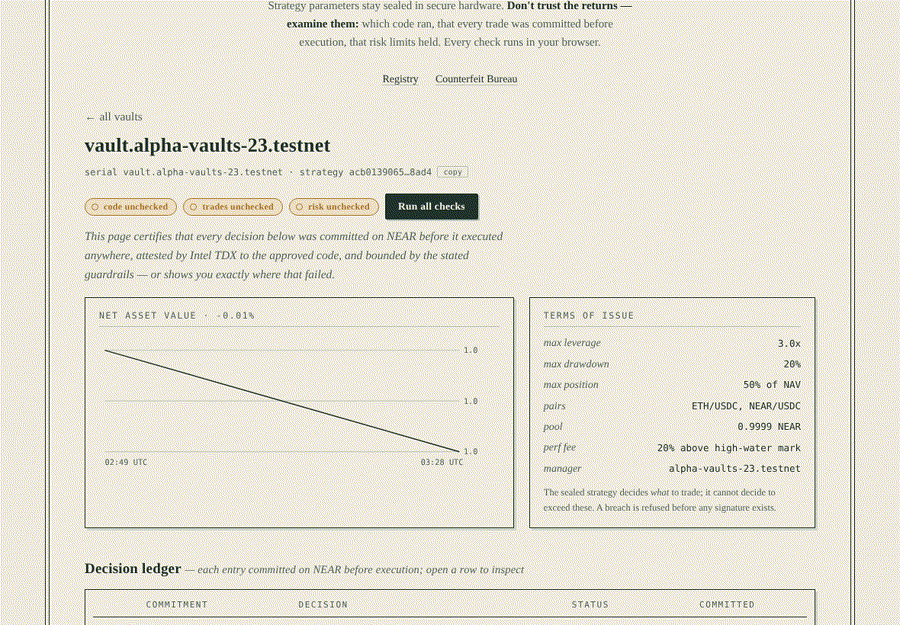
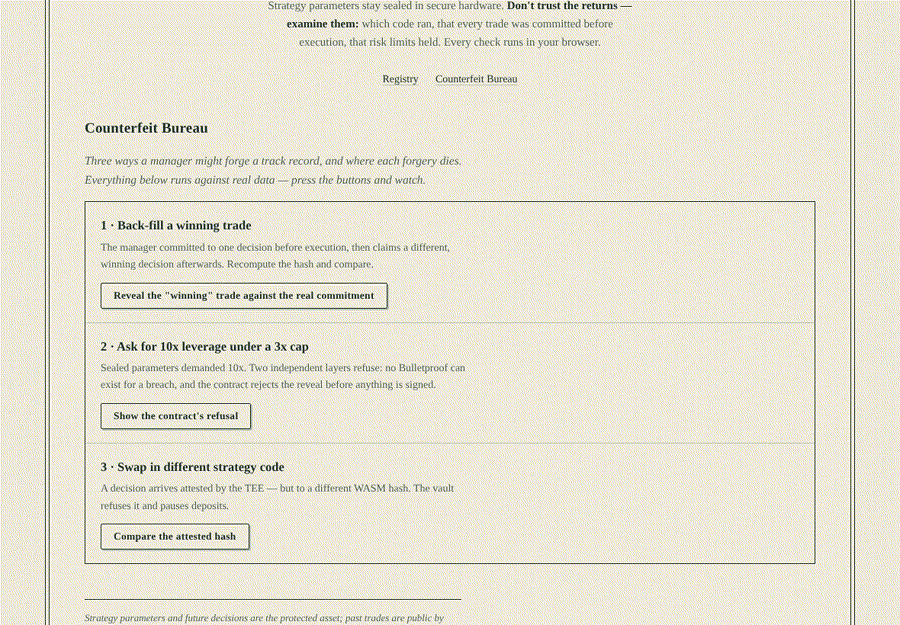

# Verifiable Alpha Vaults

AI trading vaults on NEAR where the strategy's parameters stay sealed in Intel TDX hardware, while every claim an investor needs (which code ran, that no trade was back-filled, that risk limits held, that returns are real) can be checked by anyone, in a browser, without trusting us.

Built at NEAR HACKATHON (Nov 2026), solo. Live on NEAR testnet. A 16-page product document with diagrams is in [`docs/Product-Document.pdf`](docs/Product-Document.pdf).

## The problem

- **Investors can't verify AI fund managers.** They can't see which code runs, whether the track record was back-filled, or whether "max 3x leverage" was ever enforced.
- **Managers can't prove themselves without leaking the edge.** Publishing a strategy gets it copied; hiding it means nobody can trust it.

## The solution in one paragraph

The strategy's **code is public** (anyone can read it and check its hash), its **parameters are sealed** in an Intel TDX enclave on OutLayer, and its **behaviour is provable**:

- Every decision is hashed on NEAR before it executes.
- The vault contract refuses anything outside its risk limits.
- Bulletproofs show private risk metrics stayed in range.
- The vault signs its own Uniswap trades through NEAR Chain Signatures, at the size the enclave chose.
- Value comes back as NEAR through NEAR Intents.

## Try it: do X, see Y

| Do | See |
|---|---|
| `./scripts/judge-check.sh` | 56 Rust tests (incl. a property-based fuzz of the money rules) and 4 executor tests pass; one full decision cycle runs offline; then six read-only checks run against the live testnet vault. Ends with a PASS/FAIL summary. |
| Open the site ([hosted](https://amudhan23.github.io/verifiable-alpha-vaults/) or `cd frontend && python3 -m http.server 8080`), open `vault.alpha-vaults-23.testnet`, press **Run all checks** | Four seals turn green, computed in your browser: TDX attestations match the approved code, every decision recomputes to its earlier on-chain hash, Bulletproofs verify, enclave inputs match their attested hashes. |
| On the site, open the **Counterfeit Bureau** and try a cheat: back-fill a trade, demand 10x leverage, swap the code | Each attempt is refused, and the page shows which rule caught it. |
| `cd executor && npm ci && node verify.mjs --vault vault2.alpha-vaults-23.testnet` | 5/5 checks pass, including a swap on Sepolia whose calldata ends in the hash of the decision committed before it. |
| Open [the attested swap on Sepolia](https://sepolia.etherscan.io/tx/0xa7ca6d0ebe7144bb829194832ea047c9c7a6594dbada642bbbd5a97fc19f13a1) | A sell of 0.01308 ETH sent from the vault's own address; the size and the 38.46 USDC floor were chosen inside the enclave; the input data ends in commitment `55b77309…`. |
| `node executor/run.mjs` | One full cycle against a local enclave: decide, commit, reveal, guardrail check, Bulletproofs. No network or keys needed. |

Every claim with its code, its test and a live transaction: [`VERIFY.md`](VERIFY.md).

## What's live, and what isn't

| Piece | Status |
|---|---|
| Vault contract (v5) with shares, guardrails, commit-then-reveal, timelocks, emergency exit | **Live** on testnet (`vault.alpha-vaults-23.testnet`, `vault2.alpha-vaults-23.testnet`) |
| Strategy in Intel TDX (OutLayer) with sealed parameters | **Live** (relayed over HTTPS on the main vault) |
| Attested mode: the vault requests the run on-chain and receives it in its own callback | **Live** on the rehearsal vault (full cycle with a swap); switched on for the main vault 14 Nov |
| Vault-signed Uniswap swaps via Chain Signatures | **Live** on Ethereum Sepolia |
| NEAR Intents way back (USDC to NEAR) | Arrival half **live** on testnet; send half built and tested but mainnet-only, because NEAR Intents has no testnet; live 1Click quotes |
| Mainnet (trading on Base) | Built and tested, **not deployed** |
| Professional audit | **No**. Two independent AI-assisted reviews, see [`docs/SECURITY.md`](docs/SECURITY.md) |

## How NEAR is used

- **Vault contract on NEAR** (near-sdk, Rust): holds the money and enforces every rule.
- **OutLayer** (NEAR's TEE network, Intel TDX): runs the sealed strategy. Its on-chain `request_execution` can only be resolved by DCAP-verified TDX workers, so a decision delivered to the vault's callback is attested by construction.
- **Chain Signatures** (NEAR MPC): the vault contract controls its own Ethereum address and signs its own swaps; no relayer wallet ever holds the funds.
- **NEAR Intents** (1Click): brings cross-chain value back to the vault as NEAR.
- **NEP-171**: the strategy is an NFT. Its holder earns the performance fee and proposes changes; a pending proposal lapses if the NFT is sold.

### Security, reviewed adversarially

Two independent reviews attacked the vault. The first found **3 Critical issues in v3**: the executor could drain the pool through misreported valuations, the cross-chain wallet was the executor's rather than the vault's, and claims could overpay. v4 fixed all three. The second asked what the relayer can *still* do. **v5 (live) answers with two honest modes:**

- **Relayed** (running today): a named relayer delivers enclave output. It is trusted for liveness and for the valuation shown on the chart, and for nothing else.
  - Trade sizes and slippage floors come from the enclave's committed decision.
  - Deposits only open while the vault is fully in NEAR.
  - Fees only come from NEAR that has actually returned.
  - Withdrawals pay an exact pool slice.
  - The vault's EVM wallet can never change.
  - The relayer pays for every byte it writes.
- **The way back** (DeFi track): cross-chain USDC returns as NEAR through **NEAR Intents**.
  - **Send:** the manager proposes an exit to a 1Click deposit address; it's public for 24h, then the vault signs one transfer.
  - **Arrive:** anyone can call `unwrap_and_repatriate` to credit the delivered NEAR to holders.
  - **Status:** the vault page shows a live 1Click quote for the vault's holdings. NEAR Intents is mainnet-only, so the send half is built and tested but runs on mainnet; the arrival half ran live on testnet.
- **Attested** (working on testnet; switched on once strategy v2 is applied Sat 14 Nov): only TDX-attested output delivered on-chain can commit, trade, settle or prove. The vault calls OutLayer's `request_execution` itself, and only DCAP-verified workers can answer. Commitment #18 was created by the vault's own callback this way, with its Bulletproofs anchored from the enclave's delivery. Switching it on is immediate; switching back takes 48h.

Every finding, fix and regression test, plus the residual risks, is in [`docs/SECURITY.md`](docs/SECURITY.md).

### Every claim, checked in your browser

Four seals, four independent checks against public data. None trust our server:

1. **Attested**: TDX attestations fetched from OutLayer's public API; the code that executed = the code the vault recorded (and enforced) for each decision.
2. **Committed**: every revealed trade recomputes to the hash committed on NEAR *before* execution.
3. **In limits**: Bulletproof range proofs verified in-browser (leverage ≤ 3x, drawdown ≤ 20%).
4. **Priced**: each enclave input is published on-chain, hashes to the attested `input_hash`, and its oracle price matches public market history. The strategy provably saw real prices.

Execution is a real Uniswap v3 swap through NEAR Chain Signatures. The **vault contract** builds and MPC-signs the transaction. It uses exactly the amount, 2% floor and fee tier the enclave committed, and the commitment rides in the swap's calldata. Cross-chain PnL settles back into NAV through the enclave. Returns are NAV **per share**. Details and every tx: [`docs/DEPLOYMENT.md`](docs/DEPLOYMENT.md).

### Use it

Open a live vault page, **Connect wallet** (Meteor, MyNearWallet or Intear on NEAR testnet), and deposit or withdraw. Each action is a transaction you sign in your own wallet. Deposits are open only while all of the vault's value is NEAR held by the contract, so a valuation report never sets the price you pay. If the vault ever goes silent past its liveness timeout, the same panel offers **Trigger emergency exit** and **Claim recovered funds**.

### What is protected — and what is not

> **The protected asset is the strategy's parameters and its future
> decisions.** Past trades, once executed on a public chain, are visible after
> the fact — by design: that's what makes returns auditable. What competitors
> can never extract is the tuning (lookbacks, thresholds, sizing) that
> generates the *next* decision, and nobody — including the vault manager —
> can front-run a decision that is still sealed. The Bulletproof layer
> additionally keeps epoch risk *metrics* (peak leverage, drawdown path)
> private while proving they stayed within the public limits.




## Architecture

```
investor ──deposit──► Vault contract (NEAR, near-sdk Rust)
                        │  shares · guardrails · commitment log · proof anchor
                        │
   sealed params ──►  Strategy WASM in TDX enclave (OutLayer)
   (OutLayer secret)    │  decide → commit hash → Bulletproofs risk proof
                        ▼
                      commit_decision (hash on NEAR, pre-execution)
                        ▼
                      execute_decision (reveal + guardrail check)
                        ▼
                      Chain Signatures (v1.signer-prod.testnet) ──► EVM testnet swap
                        ▼
                      browser verifies: attestation · commitments · range proofs
```

- Performance fees respect an on-chain **high-water mark** and are charged only on **realized** gains. The strategy itself is a **NEP-171 NFT**: whoever holds it earns the fees and may propose code, mode and contract changes. Each one is public for 48h before it applies, and it lapses if the NFT is sold. Sell the NFT and the verified track record goes with it.

- `crates/proofs` — Pedersen commitments + aggregated Bulletproofs proving
  `secret value ≤ public limit` (a 10x-leverage epoch **cannot produce a
  proof**); compiles to WASM for in-browser verification.
- `contracts/vault` — shares, guardrails, commit-then-reveal log, attested
  decision entrypoints, risk-proof anchor.
- `strategy` — public momentum strategy code, **sealed parameters** via
  OutLayer secrets (env-injected inside the enclave only).
- `scripts/` — OutLayer setup + testnet go/no-go.
- `executor/` — the relayer: oracle → enclave → commit → reveal → vault-signed swap → proof → bounded settlement.
- `frontend/` — registry, vault pages with four in-browser checks, wallet sign-in, Counterfeit Bureau.

## Run everything (no network needed)

```bash
cargo test --workspace          # 56 Rust tests incl. a property-based fuzz of the money invariants
(cd executor && npm ci)         # once
node executor/test.mjs          # 4 executor tests incl. a full local-enclave cycle
node executor/run.mjs           # one full cycle, offline: enclave -> commit -> reveal -> proof
```

To see the product, serve the frontend and open http://localhost:8080 —
leaderboard, vault pages with in-browser verification, and the red-team console:

```bash
cd frontend && python3 -m http.server 8080
```

(The demo fixtures' commitments and Bulletproofs are REAL — regenerate with
`cargo run -p gen-fixtures`. The browser verifier wasm in `frontend/pkg/` is
built and committed by CI; rebuild anything with `scripts/build-wasm.sh`.
Add `?autocheck` to the URL to run the checks on page load.)

The Rust suite runs the full pipeline end-to-end
(`contracts/vault/tests/pipeline.rs`) and the three **"try to cheat"**
scenarios:

1. *Back-fill a winning trade* → reveal doesn't match the prior commitment → aborted.
2. *Ask for 10x leverage (cap 3x)* → no Bulletproof can exist **and** the
   contract refuses before anything would be signed.
3. *Swap the strategy code* → attested hash ≠ approved hash → refused, deposits pause.

Run the strategy exactly as the enclave does (stdin in, sealed params as env,
stdout out):

```bash
echo '{"epoch":1,"nonce":1,"pair":"ETH/USDC","prices":[100,100,100,100,100,102,105,109,114,120],"nav_yocto":"990","peak_nav_yocto":"1000","max_leverage_bps":30000,"max_drawdown_bps":2000}' \
| STRATEGY_PARAMS='{"fast":3,"slow":8,"threshold_bps":50,"size_bps":4000,"leverage_bps":25000}' \
cargo run -q -p vault-strategy
```

### Red-team console

The frontend ships a console that runs the three cheats live:



## Testnet deployment

Live vault: `vault.alpha-vaults-23.testnet` (v5). Its EVM wallet on Sepolia is
`0x63fbAd3b0Ee56433861907EE75963e59326D9B6f`. Contract addresses, transactions
and the upgrade history are in [`docs/DEPLOYMENT.md`](docs/DEPLOYMENT.md). To
set up your own: `scripts/outlayer-setup.md`, then `node executor/deploy.mjs`.

## Trust model, stated plainly

- **TEE trust**: confidentiality of the parameters rests on Intel TDX and on
  OutLayer's platform (worker registry: `worker.outlayer.testnet`). The
  attestation chain (source → WASM hash → input hash → output hash → TDX
  quote) is independently checkable; the worker image, once approved in the
  registry, is trusted to run the WASM it names.
- **On-chain** (enforced by the vault): code-hash match, enclave-input state
  consistency (no doctored NAV), commitment ordering, guardrails, enclave-sized
  trades only, deposits only while fully in NEAR, fees only on realized gains,
  liveness-based emergency exit.
- **Relayed mode (live today)** trusts the relayer for two things: running on
  time, and the cross-chain valuation drawn on the chart. Its attestations are
  checkable off-chain by anyone (the four seals). **Attested mode** removes the
  relayer from both: only OutLayer's on-chain `request_execution`, which only
  DCAP-verified TDX workers can resolve, can act. It works on testnet
  (`node executor/run.mjs --enclave onchain --vault near`). The market
  inputs are still supplied by the requester in either mode; the browser's
  price check compares them against public history.
- **Exit guarantees:** if no attested decision lands for 24h, anyone can
  trigger a one-way emergency exit. Withdrawals pay the NEAR pool pro rata and
  record claims on cross-chain value. The vault's EVM wallet is fixed forever.
- **Upgrades:** after the final deploy the vault account's full-access key is
  deleted. From then on, code can only change through `propose_code` → 48h →
  `apply_code`, with the new code's hash public the whole time.
- **The enclave is not the enforcement point.** Even a malicious strategy
  (or malicious parameters) cannot exceed the guardrails: the contract checks
  every reveal before an execution signature exists.
- Built for the NEAR hackathon (Nov 2026). **Not** audited; testnet only.
  Shade Agents were not used (deprecated Apr 2026); the TEE path is OutLayer.

## Where this goes

- **Who pays.** Strategy creators earn a 20% performance fee on realized gains above a high-water mark, paid to whoever holds the strategy NFT. A protocol share of that fee is the natural business model. Investors pay nothing to deposit or withdraw.
- **Why it can grow.** Every vault builds a track record nobody can fake. Strategy NFTs carry that record and the future fees, so good strategies become tradable assets, and new strategies can enter without a brand, just with proofs.
- **Next steps:**
  1. A manager-only mainnet vault on Base; the build is ready.
  2. An enclave that fetches its own prices.
  3. A factory contract and web form, so designers launch vaults without the command line.
  4. A professional audit before outside deposits.

## Built with, and disclosure

- **Everything here was written during the hackathon window.** The first commit is 11 Nov 2026; there is no pre-hackathon code.
- **AI-assisted.** Most of the code and docs were written with an AI coding assistant (Claude, by Anthropic) directed by the author, which is allowed by the rules. Both security reviews were also AI-assisted and are documented in [`docs/SECURITY.md`](docs/SECURITY.md).
- **Main libraries.** These are the direct dependencies; `Cargo.toml` and `package.json` have the full lists.
  - Rust: `near-sdk`, `near-contract-standards`, `bulletproofs`, `curve25519-dalek-ng`, `merlin`, `sha2`, `chacha20poly1305`, `uint`, `proptest`.
  - JavaScript: `near-api-js`, `chainsig.js`, `viem`, `@noble/ciphers`, `@near-wallet-selector`.
- **External services:** OutLayer (TDX enclaves), NEAR MPC (Chain Signatures), NEAR Intents 1Click API, Uniswap v3, Pyth and CoinGecko price feeds.

## License

MIT, see [`LICENSE`](LICENSE).
