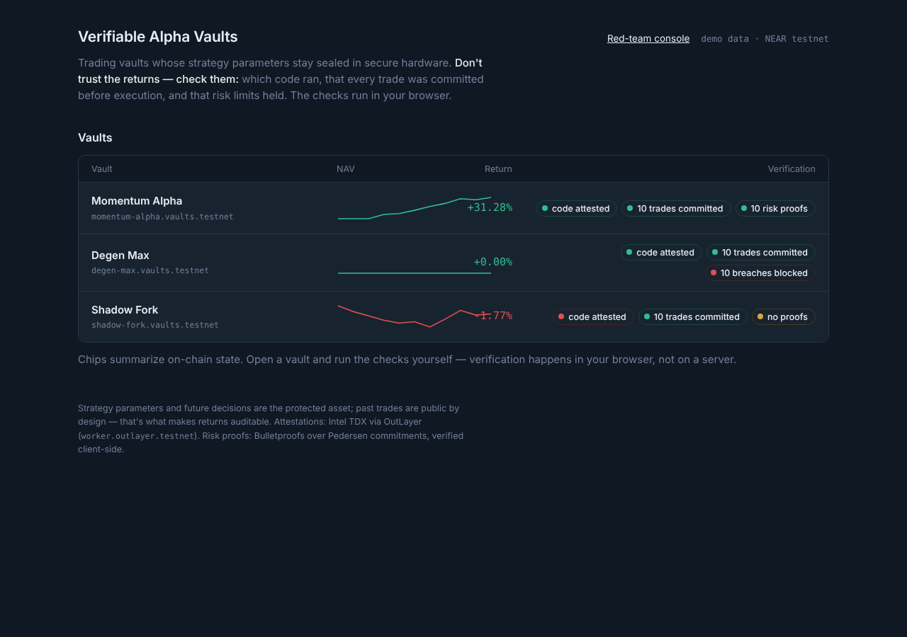
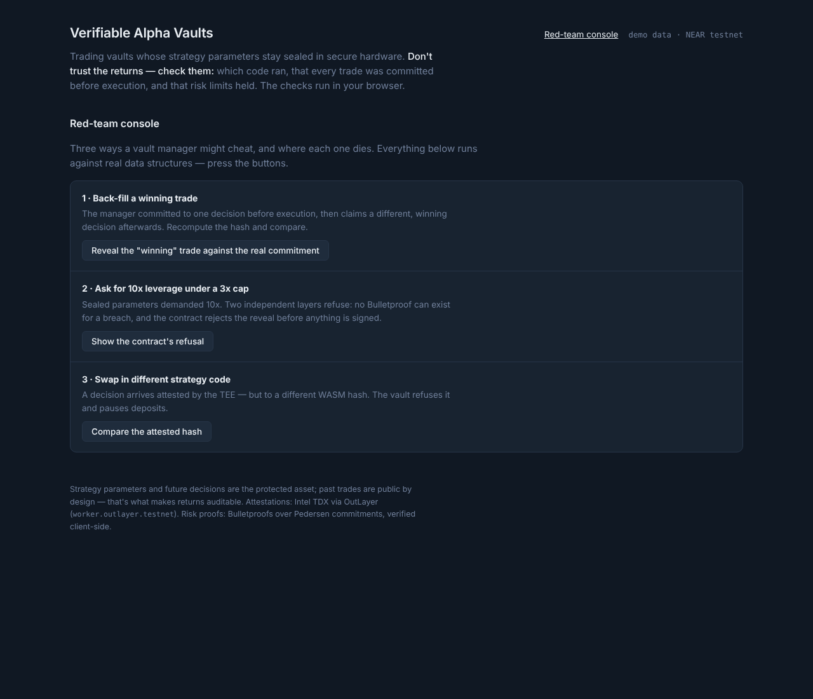

# Verifiable Alpha Vaults

**AI trading vaults where the strategy's parameters stay sealed in secure
hardware — and everything an investor needs to check is provable.**

Traders can't raise money without showing their strategy; once shown, it gets
copied and front-run. Investors can't trust a black box. Alpha Vaults seals the
strategy's *parameters* inside an Intel TDX enclave (OutLayer) and makes four
things independently verifiable:

| # | Claim | How it's verified |
|---|-------|-------------------|
| 1 | **Which code ran** | TDX hardware attestation of the strategy WASM hash (OutLayer); the vault contract refuses decisions attested to any other hash and pauses deposits |
| 2 | **No back-filling** | Every decision's hash is committed on NEAR *before* execution; a reveal that doesn't match a prior commitment aborts |
| 3 | **Risk limits held** | Guardrails (leverage ≤ 3x, position caps, asset allowlist) enforced in the contract before anything is signed, **plus** Bulletproofs range proofs that private risk metrics stayed in range — verified in your browser |
| 4 | **Real returns** | Share accounting and NAV history are on-chain; returns computed from balances + oracle |

### What is protected — and what is not

> **The protected asset is the strategy's parameters and its future
> decisions.** Past trades, once executed on a public chain, are visible after
> the fact — by design: that's what makes returns auditable. What competitors
> can never extract is the tuning (lookbacks, thresholds, sizing) that
> generates the *next* decision, and nobody — including the vault manager —
> can front-run a decision that is still sealed. The Bulletproof layer
> additionally keeps epoch risk *metrics* (peak leverage, drawdown path)
> private while proving they stayed within the public limits.



## Architecture

```
investor ──deposit──► Vault contract (NEAR, near-sdk Rust)
                        │  shares · guardrails · commitment log · proof anchor
                        │
   sealed params ──►  Strategy WASM in TDX enclave (OutLayer)
   (OutLayer secret)    │  decide → commit hash → Bulletproofs risk proof
                        ▼
                      commit_decision (hash on NEAR, pre-execution)
                        ▼
                      execute_decision (reveal + guardrail check)
                        ▼
                      Chain Signatures (v1.signer-prod.testnet) ──► EVM testnet swap
                        ▼
                      browser verifies: attestation · commitments · range proofs
```

- `crates/proofs` — Pedersen commitments + aggregated Bulletproofs proving
  `secret value ≤ public limit` (a 10x-leverage epoch **cannot produce a
  proof**); compiles to WASM for in-browser verification.
- `contracts/vault` — shares, guardrails, commit-then-reveal log, attested
  decision entrypoints, risk-proof anchor.
- `strategy` — public momentum strategy code, **sealed parameters** via
  OutLayer secrets (env-injected inside the enclave only).
- `scripts/` — OutLayer setup + testnet go/no-go.
- `frontend/` — leaderboard, vault page, three verification badges (WIP).

## Run everything (no network needed)

```bash
cargo test --workspace          # 31 Rust tests (proofs, contract, strategy, pipeline)
node executor/test.mjs          # 4 executor tests incl. a full local-enclave cycle
node executor/run.mjs           # one full cycle, offline: enclave -> commit -> reveal -> proof
```

To see the product, serve the frontend and open http://localhost:8080 —
leaderboard, vault pages with in-browser verification, and the red-team console:

```bash
cd frontend && python3 -m http.server 8080
```

(The demo fixtures' commitments and Bulletproofs are REAL — regenerate with
`cargo run -p gen-fixtures`. WASM artifacts: `scripts/build-wasm.sh`.)

The Rust suite runs the full pipeline end-to-end
(`contracts/vault/tests/pipeline.rs`) and the three **"try to cheat"**
scenarios:

1. *Back-fill a winning trade* → reveal doesn't match the prior commitment → aborted.
2. *Ask for 10x leverage (cap 3x)* → no Bulletproof can exist **and** the
   contract refuses before anything would be signed.
3. *Swap the strategy code* → attested hash ≠ approved hash → refused, deposits pause.

Run the strategy exactly as the enclave does (stdin in, sealed params as env,
stdout out):

```bash
echo '{"epoch":1,"nonce":1,"pair":"ETH/USDC","prices":[100,100,100,100,100,102,105,109,114,120],"nav_yocto":"990","peak_nav_yocto":"1000","max_leverage_bps":30000,"max_drawdown_bps":2000}' \
| STRATEGY_PARAMS='{"fast":3,"slow":8,"threshold_bps":50,"size_bps":4000,"leverage_bps":25000}' \
cargo run -q -p vault-strategy
```

### Red-team console

The frontend ships a console that runs the three cheats live:



## Testnet deployment

See `scripts/outlayer-setup.md`, then `scripts/go-no-go.sh`. (Deployment
details and live contract addresses land here once deployed.)

## Trust model, stated plainly

- **TEE trust**: confidentiality of the parameters rests on Intel TDX and on
  OutLayer's platform (worker registry: `worker.outlayer.testnet`). The
  attestation chain (source → WASM hash → input hash → output hash → TDX
  quote) is independently checkable; the worker image, once approved in the
  registry, is trusted to run the WASM it names.
- **On-chain verification** covers code-hash matching, commitment ordering,
  and guardrails. Full TDX quote verification and Bulletproof verification
  happen client-side (browser WASM) — on-chain verification of either is gas-
  prohibitive and unnecessary for the guarantee.
- **The enclave is not the enforcement point.** Even a malicious strategy
  (or malicious parameters) cannot exceed the guardrails: the contract checks
  every reveal before an execution signature exists.
- Built for the NEAR hackathon (Nov 2026). **Not** audited; testnet only.
  Shade Agents were not used (deprecated Apr 2026); the TEE path is OutLayer.
