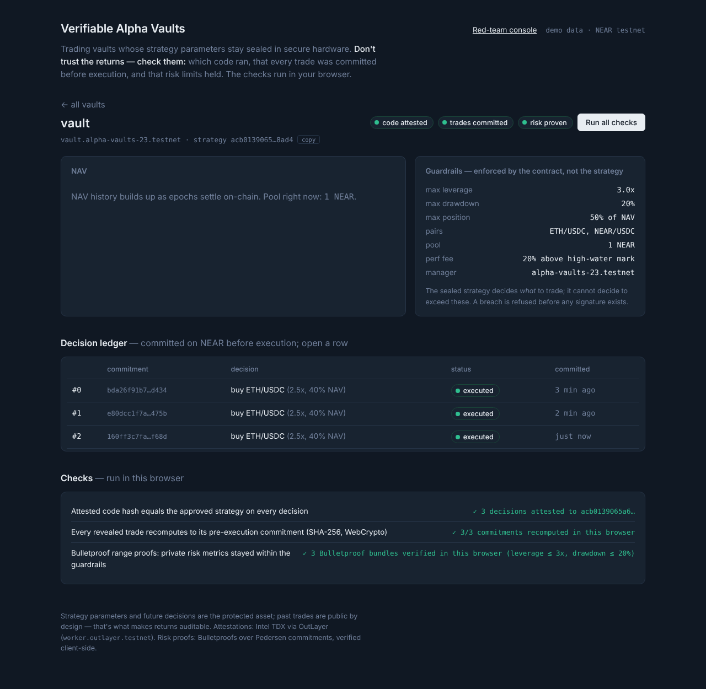

# Live testnet deployment (Wed 11 Nov 2026, ~21:50 ET)

| What | Where |
|---|---|
| Vault contract | `vault.alpha-vaults-23.testnet` ([explorer](https://testnet.nearblocks.io/address/vault.alpha-vaults-23.testnet)) |
| OutLayer project | `alpha-vaults-23.testnet/alpha-vault-strategy` |
| Approved/attested strategy wasm | `acb0139065a6297979e955940247ce4303cd189b146603a595012c6c7bf08ad4` |
| Strategy wasm (FastFS) | https://test.fastfs.io/alpha-vaults-23.testnet/outlayer.testnet/acb0139065a6297979e955940247ce4303cd189b146603a595012c6c7bf08ad4.wasm |
| Sealed params | OutLayer secret `STRATEGY_PARAMS`, profile `default` (encrypted on-chain; decrypted only in the enclave) |
| First attested run (go/no-go) | call `c47fe5dd-a57c-4f83-84b2-bc1ce7e96215`, 923 ms, TDX quote verified |
| Frontend live mode | `?vault=vault.alpha-vaults-23.testnet` |

Go/no-go verdict: **GO** (Wed night, 14h ahead of the deadline). All three
browser checks green against live chain data: 3 decisions attested, 3/3
commitments recomputed, 3 Bulletproof bundles verified in-browser.



Run a new attested cycle (needs the executor env, see `executor/.env.example`):
```bash
cd executor && node run.mjs --enclave outlayer --vault near
```

## Chain Signatures: live cross-chain execution (Wed ~22:30 ET)

- Derived EVM address (MPC-controlled, no private key exists): `0x18f92b8Ee2DC4bC3bbBDB4138E92F184bc405B7f` (path `alpha-vault-v1`)
- First live trade: commitment #5 on NEAR → MPC signature from `v1.signer-prod.testnet` → [Sepolia tx `0x25d727…bd4a`](https://sepolia.etherscan.io/tx/0x25d727ebe6836e9ab6b887af8b6727ebb30aca6586484d29ef84c8aedb59bd4a) carrying the commitment hash in calldata → execution ref recorded back on the vault.
- The chain of custody is fully public: NEAR commitment (pre-execution) ↔ Sepolia calldata ↔ reveal + attestation.
- Note: commitments #3/#4 remain `Committed` (sealed) — artifacts of executor-crash runs; their decisions were never revealed, which the ledger displays honestly.

## Red-team, live on-chain (Thu 12 Nov, ~04:20 ET)

All three cheats were attempted for real against `vault.alpha-vaults-23.testnet`:

| Cheat | On-chain result |
|---|---|
| 10x leverage under the 3x cap | commitment #6: `Rejected — leverage 100000bps exceeds max 30000bps` (permanent ledger entry) |
| Back-fill a winning trade | tx [`9RZeAaK6hzuATMga9qrWQFsukkCqZ9DWeXKWcRKyuNS3`](https://testnet.nearblocks.io/txns/9RZeAaK6hzuATMga9qrWQFsukkCqZ9DWeXKWcRKyuNS3): `Smart contract panicked: reveal does not match commitment: this trade was not committed when claimed` — the honest reveal of the same commitment then succeeded |
| Swapped strategy code | recorded as `Rejected` + integrity alert + deposits paused (unit + pipeline tested; not run against the live vault to keep it depositable) |

## Build note: `--cfg near` (important)

near-sdk 5.30 compiles its host functions only under `--cfg near`
(what `cargo near build` sets). A plain cargo wasm build silently gets
pure-Rust fallbacks: sha256 still computes correctly, but every panic
becomes a raw `unreachable` trap and messages are lost. We build with
`RUSTFLAGS="--cfg near"` (see scripts/build-wasm.sh); found the hard way,
fixed, and verified: on-chain errors now read `Smart contract panicked: …`.

Known ledger artifacts kept honestly: #3/#4 forever `Committed` (sealed) from
executor-crash runs; #6 the rejected 10x breach; #7–#8 red-team targets.

## Thursday upgrade: the core loop, closed (12 Nov)

| Gap | Status | Evidence |
|---|---|---|
| **Real oracle, bound into the attestation** | ✅ live | Executor fetches Pyth (→ CoinGecko fallback) and puts prices + timestamp in the enclave input. The vault publishes the exact `input_json`; `sha256(input_json)` = the TDX attestation's `input_hash` (verified: commitment #10 ↔ call `d56d3cfc…`, hash `f001685e…`). The browser re-checks the price against CoinGecko's public history at `as_of` (±2%). Feeding the strategy fake prices is now detectable. |
| **Real DEX execution** | ✅ live | Uniswap v3 on Sepolia (SwapRouter02 `0x3bFA…e48E`, addresses verified on-chain). Commitment #10: [wrap](https://sepolia.etherscan.io/tx/0xb29a03063124cdf929c87fed3ac19c32b98f3ee1257f14c1287fd29e24c278eb) → [approve](https://sepolia.etherscan.io/tx/0x7d5ed8d56a7ead8d20a42f3479fe83df55c61cd232e8a2a7060f382191b119ec) → [swap WETH→USDC](https://sepolia.etherscan.io/tx/0xa6f00795ad319fce27c3b74c64193fb00ff3249fc6522678d7ae097a3baa535f), all MPC-signed. Best fee tier via QuoterV2, 2% `amountOutMinimum`, receipt-checked (a revert is recorded as `reverted:<hash>`, never as a fill). The 32-byte commitment is appended after the ABI args, so every swap is tied to its NEAR commitment. |
| **PnL settles into NAV** | ✅ live | `settle_pnl`: the enclave values cross-chain holdings from balances in its (attested, published) input; anyone can re-read Sepolia at `evm_block` and compare. The first settlement is booked as **seed capital** (shares minted at NAV/share) so out-of-band funding can never show up as return. Returns are computed from NAV **per share**. |
| **De-trust the executor (yield/resume)** | ✅ live on testnet (see "Update" below) | `request_decision` makes the vault itself call `outlayer.testnet` `request_execution` with the build **pinned** (`version_key` = approved hash; OutLayer confirmed: "Resolved project … version: 1592…"). The decision + salt come back as ChaCha20-Poly1305 ciphertext (`sealed_enc`) because callback results are public. In 3 attempts (both WasmUrl and Project sources) the testnet worker never resumed within NEAR's 200-block yield window, while the HTTPS path answers in <1s, so live cycles use HTTPS. Txs: `FcWvc7jf…`, `HTCNWMh2…`. |

### New safety rails
- **Pool-vs-oracle deviation guard (5%)**: refuses to trade into a pool priced away from the oracle (manipulation / thin liquidity). Sepolia pools trade about 14× off real ETH prices, so testnet swaps require the explicit `ALLOW_POOL_DEVIATION=1` override, and the measured deviation is recorded with the trade. **Consequence, stated plainly:** the cycle-#10 testnet swap filled at the mispriced pool, so the next settlement will show a paper gain that a mainnet pool would not produce.
- **Secret access locked down**: the hash-keyed secret row is whitelisted to the vault + owner and locked to the exact build. Otherwise anyone could run the public wasm with our sealed params on crafted inputs and probe the strategy until they reverse-engineered it.

### Bugs found and fixed (on the live vault)
- **u128 overflow in share math.** `amount × total_shares` in yoctoNEAR (1e24 × 1e24) exceeds u128, and `saturating_mul` silently clamped it. The seed settlement minted about 3.4e14 shares instead of 29.6e24, and *any* second 1-NEAR deposit would have been mis-minted. Fixed with 256-bit `mul_div` everywhere (deposit, withdraw, fees, settlement), plus tests at real yocto scale (the old tests used tiny numbers and missed it). Live state repaired via a one-time `#[private] repair_seed_mint`, deployed **atomically** with the fix (tx `4vt3tyNV…`): NAV/share is back to 1.000.
- **State-layout change on upgrade.** New fields would have bricked the deployed vault's borsh state. Fixed with a v1→v2 `migrate`, unit-tested on real v1 state and deployed atomically with the code (tx `2rKbS8yd…`): all 10 commitments preserved.

## Exit guarantees (v3, live, tx `7SgrykuH…`)

What happens if the manager, executor, or OutLayer disappears. No admin key can block any of this:

- **Liveness timeout (24h):** every attested decision resets `last_attested_ms`. If it goes stale, **anyone** can call `trigger_emergency()`. It's one-way; the manager cannot cancel it.
- **Emergency withdraw:** pays your pro-rata share of the local NEAR pool immediately and records a pro-rata **claim** on the cross-chain value. Remaining holders keep exactly their proportion.
- **Recovery:** anyone can `deposit_recovered()` repatriated value; `claim_recovered()` pays each claimant pro rata, capped at their claim. No double-claiming (tested).
- **MPC path rotation:** `propose_mpc_path` → 48h timelock → `apply_mpc_path` (callable by anyone). Depositors who object can exit first.
- **Honest limit:** funds already on the EVM address can only move with NEAR's MPC network signing for the vault's path. The guarantee covers the NEAR side completely and makes the cross-chain side an enforceable, transparent claim. It cannot make the MPC network unnecessary.

## Risk bound to real positions (12 Nov, live)

Before: the enclave proved leverage/drawdown from numbers the executor handed it (including NAV and peak NAV) and from its own decision. A dishonest executor could flatter the proof.

Now:
- **The enclave computes risk from actual holdings.** Exposure = Sepolia ETH × oracle ÷ total NAV (vault pool + cross-chain value). Drawdown = current NAV/share vs. the **on-chain** high-water mark. The leverage bound is `max(actual exposure, what the new decision requests)`.
- **The contract checks the inputs at commit.** The enclave input's `vault_state` (pool, shares, HWM, settled external value, guardrails) must equal the vault's live state, or the commitment is refused. Live red-team: an inflated pool was rejected in tx `2huuq9iv…` with *"enclave input vault_state.pool_yocto=… but the vault has …"*.
- **Every input is now checkable:** vault state (by the contract), balances (against Sepolia at `evm_block`), prices (against public history, in-browser).
- Settlement moved to the end of the cycle, so the state checked at commit can't move mid-cycle.
- First live commitment on this basis: #12 (`basis: positions`).

**Stated plainly:** when every position sits on a public chain, these metrics are recomputable by anyone, so the Bulletproof's *hiding* adds little; its value here is a uniform, verifiable bound. Hiding matters for positions that are **not** public: exchange accounts whose API keys live in the enclave (roadmap). There, the same proof shows limits held without revealing the book. Path risk *between* runs is still unobserved; run cadence bounds it.

## Attestation verification: where it happens, honestly (12 Nov)

Investigated against OutLayer's TEE docs and the testnet register contract:

- **On-chain verification exists, at worker registration.** `worker.outlayer.testnet.register_worker` verifies each worker's TDX quote with Intel's DCAP QVL library, checks its five measurements, and records the worker's public key; only that key may call `resolve_execution`. **So results delivered through the on-chain path are attested by construction**: no relayer can forge them. Our `request_decision` uses exactly this path (build pinned, result encrypted).
- **Update (12 Nov, later):** solved, and the fault was ours. The vault passed empty `resource_limits`, so OutLayer applied its 1e9-instruction default and the strategy aborted while generating Bulletproofs (~2.3e9 needed). We read the failed runs as "no response". With an explicit 5e9 budget, `request_execution` resolves in ~10s (direct probe: tx `B8rCksMu…`), and the vault's own path works (tx `CpUKMrgD…` → commitment #18 created in the vault's callback, proofs anchored from the enclave's delivery). Repro and probe: `scripts/outlayer-onchain-probe.mjs`.
- *(Earlier, superseded:)* the testnet worker has not resumed on-chain requests within NEAR's yield window in **4 attempts** (latest tx `C9HBsfuh…`, 12 Nov), while the HTTPS path answers in <1s. Live cycles therefore use HTTPS. When the worker serves yield/resume, the vault switches with no code changes. We've asked the OutLayer team.
- **HTTPS path today:** the browser fetches each attestation, checks the executed wasm against the vault's record, and checks the published input against the attested `input_hash`. We confirmed the quote's MRTD is in the on-chain approved-measurements list (129 entries). Recomputing the quote's `report_data` Task Hash from the documented formula did **not** reproduce from the public API fields (an encoding detail we couldn't pin down), so we do **not** claim a full quote→hash binding in-browser. That remains: Task-Hash recompute + Intel signature-chain verification (dcap-qvl → wasm) client-side.
- **Bottom line:** the contract enforces code hash, input-state consistency, commitment ordering, and guardrails on-chain. Full hardware-attestation enforcement on-chain arrives with the yield/resume path (already built); until then it's verified off-chain by anyone.

## v4 (12 Nov, post-audit), live

- Atomic deploy + `migrate_v4` (tx `3se3BMTD…`): 13 commitments, NAV and external value preserved; external value converted to 1e24 shareholder-owned units.
- **Vault-owned cross-chain wallet:** `0x63fbAd3b0Ee56433861907EE75963e59326D9B6f` (MPC-derived for `vault.alpha-vaults-23.testnet` + `alpha-vault-v1`). Funds moved from the old executor-owned address.
- **Vault-signed execution, live:** commitment #16 → [approve](https://sepolia.etherscan.io/tx/0xc6c453862f0bae4bec004ffa32f77f63efc13fdfb5694107c88356c509a47e3b) → [swap](https://sepolia.etherscan.io/tx/0xe6558a05490cec51c76f63ece0b2c81d934b499b5347b7e8047266eae5a4bba7), both built and MPC-signed by the contract and broadcast by the executor only after a local hash match. (That run used the fixed demo price series to trigger a trade; its `oracle.as_of` is 0, so the browser's price check skips it rather than falsely passing it.)
- **Recorded code hash = attested hash:** the executor now reads `executed_wasm_sha256` from the attestation and passes that to the vault, never its own config.
- **Strategy rotation under timelock:** `fcb26364…` (adds enclave price validation) proposed; applicable **Sat 14 Nov 17:24 UTC**. The approved `f9a93278…` stays active until then.
- Commitments #13/#14: artifacts of the cutover (#13 committed before the executor was reordered; #14's legs reverted out-of-gas before per-tx gas estimation). Both are displayed honestly.

## v5 (12 Nov, after review 2), live

- **Strategy v2** `f64b6537…` ran in OutLayer's TDX worker (call `85f8e4f8…`). The attestation reports `executed_wasm_sha256 = f64b6537…`, its build-locked secret row loaded, and its compact output is 565 bytes (the on-chain limit is 900). It sizes every trade inside the enclave. Proposed on the vault (tx `HE8s5eQL…`), applicable **Sat 14 Nov 17:51 UTC**. It supersedes the `fcb26364…` proposal, which v2 includes (price validation).
- **Contract v5:** atomic deploy + `migrate` (tx `EGUedioDCU5v8GJptkCN5HaKZFeCRG6DmiNkvGndFTWJ`). All 17 commitments, the external units, `last_settlement_ms` and the pending strategy proposal (now bound to its proposer) were preserved. A follow-up code-only redeploy (tx `3wGBapLf…`) made `commit_decision` payable, which the first live cycle caught.
- **Code size 853 KB → 393 KB** (`-C link-arg=-s` + `wasm-opt -Oz`). That freed ~4.6 NEAR of storage stake: the unstripped v4 code had left the vault with less free balance than its pool owed.
- **First v5 cycle** (relayed): commitment #17, guardrail-checked reveal, Bulletproof bundle anchored, with the relayer paying its own storage. Settlement was correctly skipped (1h spacing).
- **Deposits are closed** on this vault while its cross-chain wallet holds value (~43.8 NEAR at the last settlement). They reopen when that value is repatriated as NEAR.
- **Attested path, live (12 Nov):** `request_decision` now passes an explicit 5e9-instruction budget. The vault called OutLayer's `request_execution` itself (tx `CpUKMrgDPGwCWXEmmQFhyfv4sLb22c6WY6bttZDm5527`, ~20s round trip). Its callback created commitment #18, anchored the Bulletproof bundle straight from the enclave's delivery, and correctly skipped a settlement that moved NAV by more than 10%. The relayer then revealed the decision whose hash the enclave had already fixed on-chain. Saturday plan: apply strategy v2, run this path once more with a trade, then `enable_attested`.

## Rehearsal vault (13 Nov): full attested trade, end to end

`vault2.alpha-vaults-23.testnet` was deployed with strategy v2 approved from the start (no timelock to wait out). Its EVM wallet is `0x594441E82Ae00F744992bC465e92a9AF441A8696`. One complete cycle, with no relayer between the enclave and the vault:

1. **Request.** `request_decision` (tx `6CD9wME5tHnHRRhwZkvZQ3j62kTgTV7TvHXjEEJzTQro`): the vault asked OutLayer on-chain, and a TDX worker answered into the vault's callback. The callback committed #2 and anchored the Bulletproofs.
2. **Reveal.** The relayer revealed the decision. Its hash was already fixed on-chain, so it could not be changed.
3. **Swap.** The vault built and MPC-signed the approve (`0x7d6bb2f8…`) and the swap (`0xa7ca6d0e…`): **sell 0.01308 ETH, size and 38.46 USDC floor chosen by the enclave**, recipient the vault's own address, `multicall` with a deadline. The swap's calldata ends in commitment `55b77309…`.

Prices came from the fixed demo series (`FIXED_TREND=down`), and the price check labels them as demo data.

Found during the rehearsal, and fixed on both vaults before Saturday:

- **Gas cap.** The v5 per-leg cap of 120k gas was too low for Sepolia WETH's `approve` (the wrap alone uses 133k). Wrap and approve are now capped at 250k.
- **Pool direction.** Sepolia's ETH/USDC pool prices ETH about 10× *above* the oracle, not below. Buys can never meet the enclave's 2% floor; sells fill well above it (0.01308 ETH returned about 422 USDC).
- **Secrets whitelist cache.** OutLayer serves a newly whitelisted caller only after a few minutes. Requests made before that time out without an answer.

## The way back: NEAR Intents (13 Nov)

- **Live quote** from NEAR Intents' 1Click API for the vault wallet's holdings: 57.94 USDC on Ethereum → 16.48 NEAR in about 45s (dry run). `node executor/intents.mjs quote`.
- **Contract:**
  - `propose_exit(deposit_address, amount_usdc, quote_ref)`: manager only, public for 24h, lapses if the NFT is sold.
  - `sign_exit_tx(...)`: executor, after the delay. Signs one USDC `transfer` to that address, capped at 120k gas.
  - `unwrap_and_repatriate()`: anyone. Reads the vault's wNEAR balance, calls `near_withdraw`, and credits holders like `repatriate`.
  - Tests: 25 unit tests, with 2 new ones for this leg.
- **Live on testnet:** the arrival half ran on the main vault. A wrap.testnet `ft_transfer` stood in for the Intents delivery (tx `Aef66ZUY…`), then `unwrap_and_repatriate` (tx `AFfuBsgvysevy8JVU5YRRB73ie5y14G5PubfqZ99kZUK`) unwrapped 0.04875 NEAR and credited it to the pool.
- **Mainnet only:** the send half (a real 1Click deposit address) needs mainnet, because NEAR Intents has no testnet deployment.
